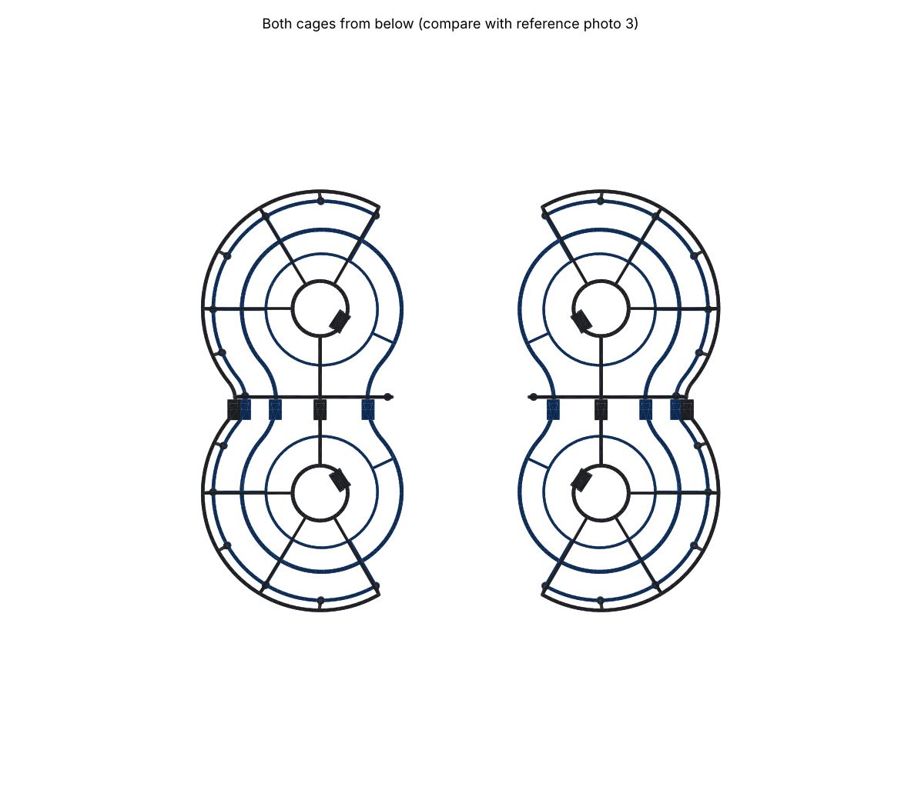

# DJI Mini 4 Pro connected 360° propeller cage (v0.3, PROVISIONAL)

A parametric, 3D-printable cage modelled on the YMTIEXNG "Prop Guard Mini4Pro" reference photos. One figure-8 cage per side encloses the front and rear propeller. Each has a top loop, a top ring over each prop, spokes, a double outer rail with open C ends, hub rings under the motors, a spine, a waist bar, ribs and snap clips.

**Status: not ready for a final print.** The scale comes from photo proportions plus a recalled DJI figure. Nothing has been measured on the drone yet. Print the clip ladders and fit tests first, after taking the measurements in `docs/MEASUREMENTS_NEEDED.md`.




## What was done and what was not

| Item | Status |
|---|---|
| Reference photos (3) | Received and measured (`docs/DIMENSIONS.md`) |
| Printables model 1411135, Amazon listing | **Not accessed.** Blocked by this environment's network policy. No third-party geometry used. |
| Parametric model | `cad/mini4pro_cage.py` (Python, manifold3d) |
| Fit tests and clip ladders | `stl/fit_tests/` |
| Full cage | `stl/provisional_cage/`, 4 parts per side. Regenerate after measuring. |
| Mesh and clearance checks | All files watertight, single solids, no keep-out intrusions, no part interference (`docs/VALIDATION.md`) |
| Fit, strength, flight | **Not tested** |

## Deviations from the photographed product

1. The side ribs are near-vertical and the upper outer rail sits in the flat lid. The photo's outward bulge cannot print without supports.
2. The inboard waist leg sits 16 mm inboard of the photo position, to clear the assumed 154 mm props.
3. The clips grip the arm next to the motor instead of cupping the motor base (motor-base shape unknown).
4. Each side is four printed parts (lid and body, split at the waist with dovetails) instead of one molding, so every part fits a 180 mm bed.

## Files

```
cad/mini4pro_cage.py      parametric model, every dimension tagged by source
cad/validate.py           mesh, clearance, interference, build-volume checks
cad/render.py             renders (set REF_IMAGES=<folder> for local photo comparisons; do not commit those)
cad/variants/light.json   about 52 g instead of 69 g (PETG, both sides)
cad/variants/measurements_TEMPLATE.json
stl/fit_tests/            print these first
stl/provisional_cage/     left/right x body/lid x front/rear
build/                    assembled-pose STLs, build and validation reports
renders/                  model views
docs/                     dimensions, measurements needed, printing, validation, attribution
```

## Regenerate

```
python3 -m venv venv && venv/bin/pip install -r cad/requirements.txt
cd cad
../venv/bin/python mini4pro_cage.py --json variants/measured.json
../venv/bin/python validate.py
../venv/bin/python render.py
```

The build takes a few seconds.
