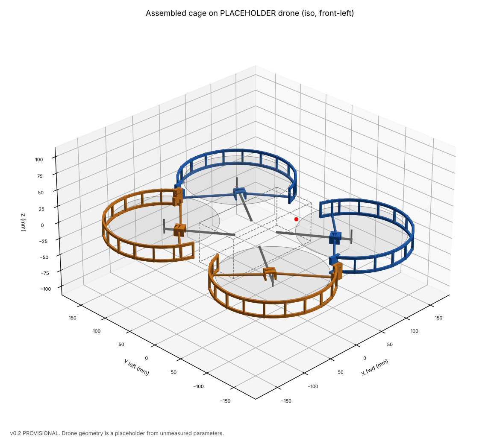
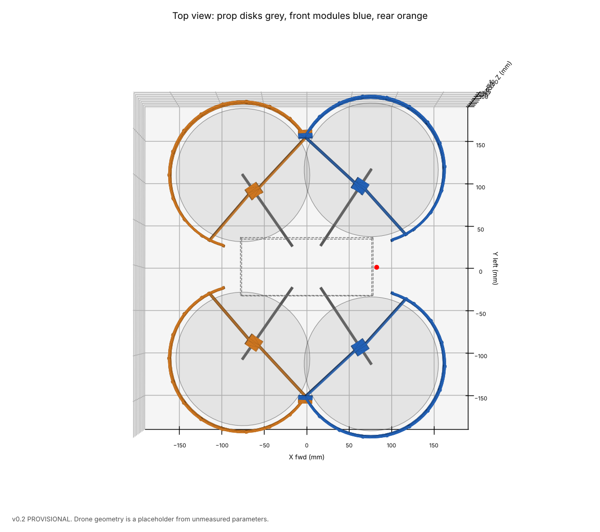
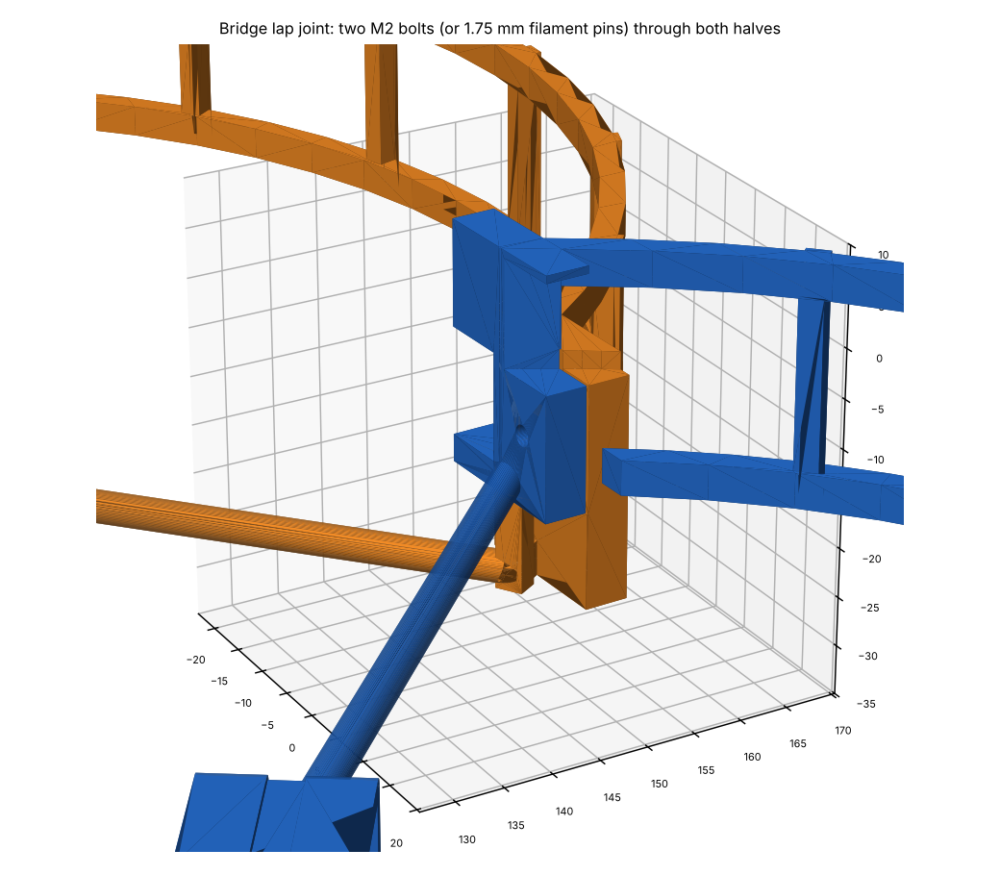
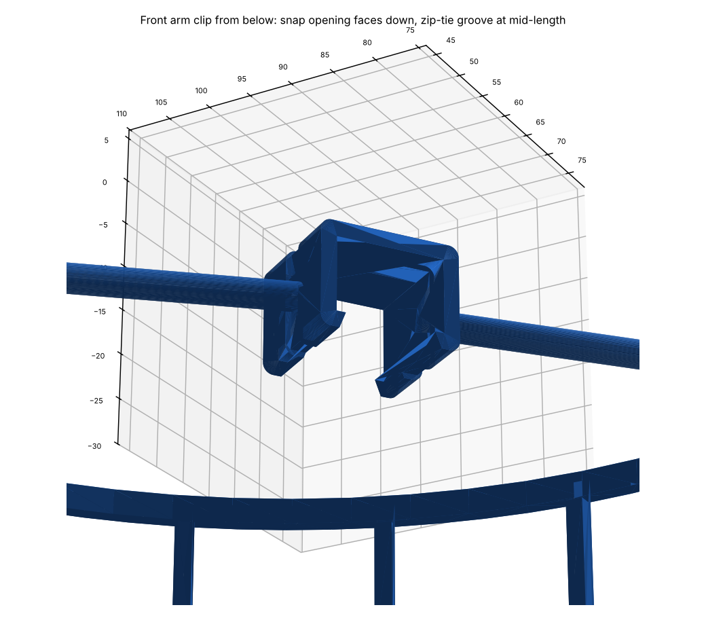

# DJI Mini 4 Pro connected propeller cage (v0.2, PROVISIONAL)

A parametric, 3D-printable cage with two connected assemblies, one per side. Each assembly protects the front and rear propeller with an upper ring, a lower rail, vertical ribs, an outboard connecting bridge and snap clips on the arms.

**Status: not ready for a final print.** The drone dimensions are placeholders or derived from recalled published specs. Print the fit tests first, after you have taken the measurements in `docs/MEASUREMENTS_NEEDED.md`.



## What was done and what was not

| Item | Status |
|---|---|
| Reference photos and concept ZIP | **Not received.** Upload folders were empty. Layout follows your written description. |
| Printables model 1411135 | **Not downloaded.** Blocked by this environment's network policy. No geometry reused. |
| Amazon listing | **Not read.** Blocked by network policy. |
| Parametric CAD (CadQuery, Python) | Done: `cad/mini4pro_cage.py` |
| Front and rear fit tests, clip clearance ladders | Done: `stl/fit_tests/` |
| Full cage STLs | Provisional only: `stl/provisional_cage/`. Regenerate after measuring. |
| Mesh validation | Done. All files watertight. See `docs/VALIDATION.md`. |
| Physical fit, strength, flight | **Not tested.** Plan in `docs/VALIDATION.md`. |

## Design

- **Upper ring + lower rail** around each prop, 6 mm radial clearance to the prop tip, joined by vertical ribs every 28 mm or less.
- **Open sector facing the fuselage** (100°), so nothing crosses the body, camera or the other side.
- **Front and rear rings meet** at an outboard point (the two prop disks overlap in plan view). An **outboard lap-joint bridge** connects them there, held by two M2 screws or filament pins. This joint is also the modular split, which keeps every part under 180 × 180 mm.
- **Snap C-clips** grip each arm from below, with a backup zip-tie groove. Two struts per clip run to the lower rail.
- A **propeller keep-out cylinder** is subtracted from every part, so no parameter change can put structure in the prop path.



| Joint | Clip |
|---|---|
|  |  |

## Files

```
cad/mini4pro_cage.py        parametric model, all dimensions tagged by source
cad/validate.py             mesh + clearance + build-volume checks
cad/render.py               PNG renders
cad/variants/light.json     lighter cage (about 42 g instead of 57 g in PETG)
cad/variants/measurements_TEMPLATE.json
stl/fit_tests/              print these first
stl/provisional_cage/       4 modules, left/right x front/rear
build/                      assembled-pose STLs, build and validation reports
renders/                    views
docs/                       dimensions, measurements needed, printing, validation, attribution
```

## Regenerate

```
python3 -m venv venv && venv/bin/pip install -r cad/requirements.txt
cd cad
../venv/bin/python mini4pro_cage.py --json variants/measured.json
../venv/bin/python validate.py
../venv/bin/python render.py
```

Without `--json` the script builds the defaults. Use `--json variants/light.json` for the light version.

## Next step

Send the measurements M1 to M10 (or the three photos) listed in `docs/MEASUREMENTS_NEEDED.md`, the product photos, and the library printer model.
